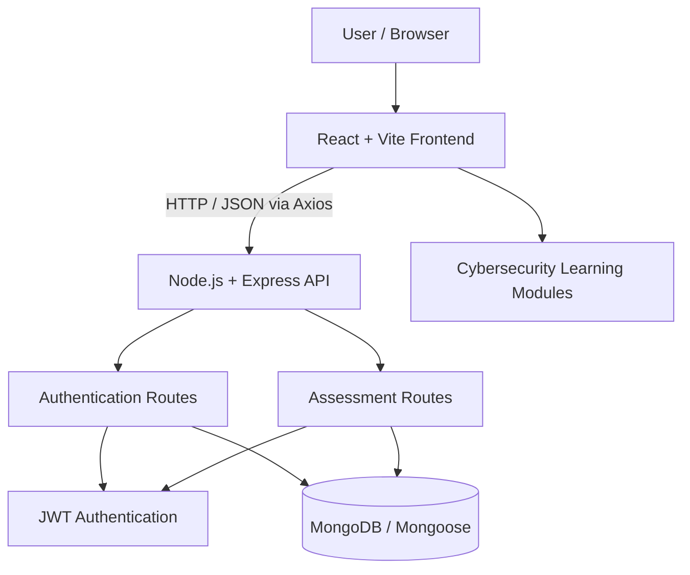
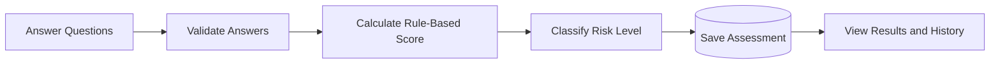
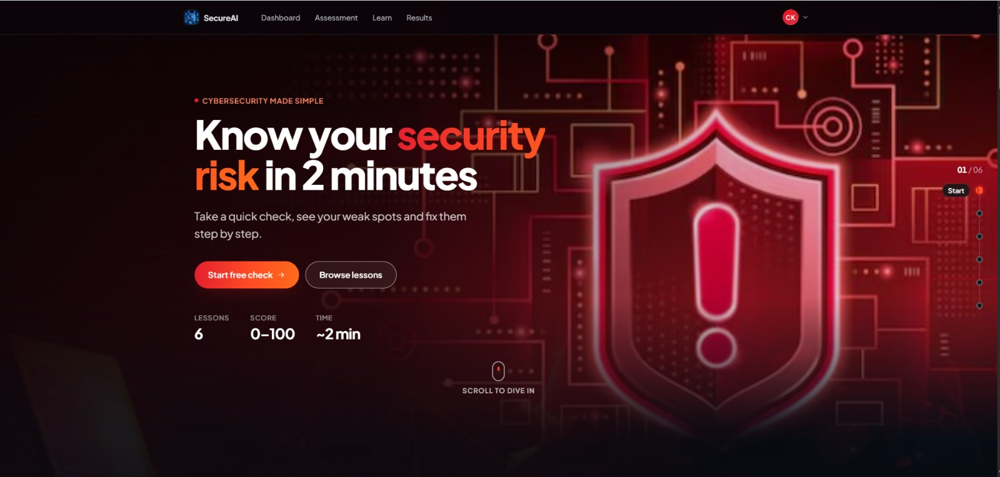
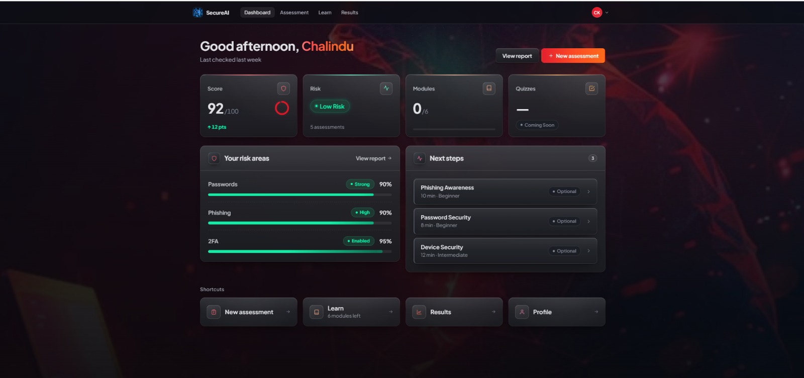
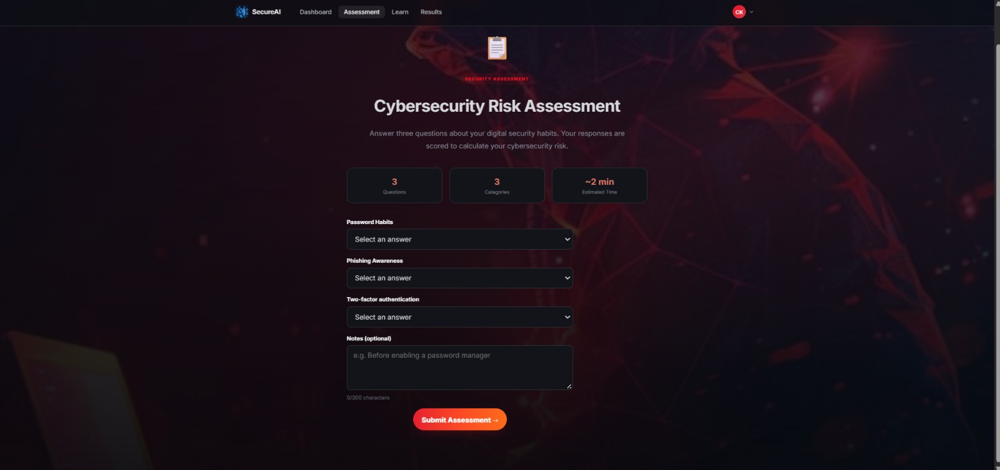
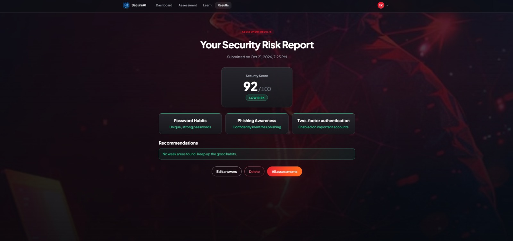

<div align="center">

# 🛡️ AI Security Awareness & Risk Assessment System

### A Full-Stack Cybersecurity Education and Personal Risk Assessment Platform

**Learn about digital threats • Assess security habits • Track your cybersecurity awareness**

[](https://react.dev/)
[](https://vite.dev/)
[](https://nodejs.org/)
[](https://expressjs.com/)
[](https://www.mongodb.com/)
[](./package.json)

[Overview](#-overview) • [Features](#-key-features) • [Architecture](#-system-architecture) • [Setup](#-getting-started) • [API](#-api-reference)

</div>

---

## 🎯 Overview

**AI Security Awareness & Risk Assessment System** is a full-stack web application designed to help users understand common cybersecurity threats, improve their online safety practices, and evaluate their personal security habits.

The platform combines structured cybersecurity learning modules with an interactive security assessment, user-specific results, and progress-oriented dashboards. It is built with the **MERN stack** (MongoDB, Express.js, React, Node.js).

> **Technical clarification:** Although *AI* appears in the project title and the learning content addresses AI-enabled cyber threats, the current assessment calculates scores using a **rule-based scoring algorithm**, not a trained machine-learning model.

## ✨ Key Features

### 🔐 Authentication & user accounts
- User registration and login
- Password hashing with `bcryptjs`
- JWT-based authentication
- Protected application routes
- User profile interface

### 📚 Cybersecurity awareness training
- Structured lessons and practical recommendations
- Dedicated cybersecurity topic pages
- Beginner, intermediate, and advanced module levels
- Awareness content about AI-generated scams and deepfakes

**Available learning modules:**

| Module | Coverage |
| --- | --- |
| 🎣 Phishing Awareness | Suspicious emails, links, SMS scams, and impersonation |
| 🔑 Password Security | Strong passwords, password managers, and account protection |
| 💻 Device Security | Updates, device locks, encryption, and backups |
| 🎭 Social Engineering | Manipulation, pretexting, baiting, and verification |
| 📶 Network Security | Wi-Fi safety, HTTPS, VPNs, and router security |
| 🤖 AI & Deepfake Threats | Synthetic media, AI-enabled scams, and verification |

### 📊 Personal security risk assessment
- Guided questionnaire covering password habits, phishing awareness, and two-factor authentication
- Server-side assessment scoring
- Risk-level classification: **High Risk**, **Medium Risk**, or **Low Risk**
- Breakdown scores by assessment category
- Saved, user-specific assessment results and history

**How scoring works:** The backend maps predefined answers to numerical scores, calculates their average, and classifies the result. A higher score represents safer reported practices.

| Score | Classification |
| --- | --- |
| 0–39 | 🔴 High Risk |
| 40–69 | 🟡 Medium Risk |
| 70–100 | 🟢 Low Risk |

### 🖥️ Application screens
The frontend includes pages for **Home**, **Login**, **Register**, **Dashboard**, **Assessment**, **Results**, **Awareness**, **Module Details**, **Profile**, and **Admin**. The presence of an Admin page does not by itself establish fully enforced admin authorization; verify authorization before deploying to production.

## 🛠️ Technology Stack

| Layer | Technology |
| --- | --- |
| Frontend | React 19, Vite 8, React Router 7 |
| User interface | CSS, Tailwind CSS, Framer Motion |
| API requests | Axios |
| Backend | Node.js, Express 5 |
| Database | MongoDB, Mongoose |
| Authentication | JSON Web Tokens (JWT), bcryptjs |
| Security middleware | Helmet, CORS |
| Development tools | npm, Nodemon, Concurrently |
| Additional dependencies | Chart.js, react-chartjs-2, React Hook Form |

## 🧩 System Architecture



### Assessment flow



## 📁 Project Structure

```text
4thsem_Webdevelopment_project/
├── client/                    # React and Vite frontend
│   ├── public/                # Static media
│   └── src/
│       ├── components/        # Navigation, authentication and UI components
│       ├── data/              # Cybersecurity awareness module content
│       ├── pages/             # Main application pages
│       ├── services/          # API, session and progress utilities
│       ├── api/               # API client
│       └── App.jsx            # Frontend routes
├── config/                    # Database configuration
├── middleware/                # Authentication middleware
├── models/                    # Mongoose data models
├── routes/                    # Authentication and assessment endpoints
├── backend/                   # Additional backend implementation
├── server.js                  # Root Express API entry point
├── package.json               # Root commands and dependencies
└── README.md                  # Project documentation
```

> **Repository note:** The current repository contains both a root backend and a separate `backend/` directory. The setup below uses the **root `server.js`**, because it is the entry point referenced by the root npm scripts.

## 🚀 Getting Started

### Prerequisites
- Node.js and npm (use a current version compatible with Vite 8)
- A running MongoDB instance or MongoDB Atlas connection
- Git

### 1. Clone the repository

```bash
git clone https://github.com/chalindu888/4thsem_Webdevelopment_project.git
cd 4thsem_Webdevelopment_project
```

### 2. Install dependencies

```bash
npm install
npm --prefix client install
```

### 3. Configure environment variables

Create `backend/.env` with your own development credentials:

```dotenv
PORT=5000
MONGO_URI=your_mongodb_connection_string
JWT_SECRET=replace_with_a_long_random_secret
NODE_ENV=development
```

The root server reads `backend/.env` and also reads `new.env` if present. Avoid keeping conflicting values in both files.

Create `client/.env`:

```dotenv
VITE_API_URL=http://localhost:5000/api
```

> **Important:** Never upload actual MongoDB credentials, JWT secrets, or other private values to GitHub. Ensure `.env` files are ignored by Git and rotate any credentials that have previously been committed.

### 4. Start the application

Run frontend and backend together from the repository root:

```bash
npm run dev
```

Alternatively, run them separately:

```bash
# Terminal 1: Backend
npm run server

# Terminal 2: Frontend
npm run client
```

Open the local URL displayed by Vite (commonly `http://localhost:5173`).

### 5. Check the backend

```bash
curl http://localhost:5000/api/health
```

The API returns a JSON health response when the server is running.

## 📡 API Reference

The following routes are mounted by the root `server.js`.

### Authentication

| Method | Endpoint | Description | Access |
| --- | --- | --- | --- |
| `POST` | `/api/auth/register` | Create a user account | Public |
| `POST` | `/api/auth/signup` | Alternative registration endpoint | Public |
| `POST` | `/api/auth/login` | Log in and receive a JWT | Public |

### Assessments

| Method | Endpoint | Description | Access |
| --- | --- | --- | --- |
| `POST` | `/api/assessment` | Submit answers and calculate risk | JWT required |
| `GET` | `/api/assessment` | Get up to 20 recent assessments for the current user | JWT required |
| `GET` | `/api/assessment/latest` | Get the current user's latest assessment | JWT required |

### System

| Method | Endpoint | Description |
| --- | --- | --- |
| `GET` | `/api/health` | API health check |

**JWT authentication:** Send `Authorization: Bearer <your_token>` for protected assessment endpoints.

**Example assessment submission:**

```http
POST /api/assessment
Authorization: Bearer <your_token>
Content-Type: application/json

{
  "passwordHabits": "strong",
  "phishingAwareness": "high",
  "twoFactorAuth": "enabled"
}
```

## 🖼️ Screenshots

Add screenshots of the actual working application to `docs/screenshots/` and then uncomment these Markdown lines:

## 🖼️ Screenshots

### 🏠 Home Page


### 📊 User Dashboard


### 🛡️ Risk Assessment


### 📈 Assessment Results


Suggested screenshots: **Home**, **Dashboard**, **Awareness Modules**, **Assessment**, **Results**, and **Profile**. Avoid screenshots containing real passwords, authentication tokens, or personal account data.

## 🔒 Security Notes

- Passwords are hashed with `bcryptjs`.
- Protected assessment routes require JWT authentication.
- The backend includes Helmet and CORS middleware.
- Assessment results are scoped to the authenticated user.
- The current source contains a development JWT fallback and restricts CORS to localhost origins. **Replace the fallback with a required environment variable and configure trusted deployment origins before production.**
- Risk levels are educational estimates based on questionnaire answers, not guarantees of security.

## 🗺️ Possible Future Improvements

- Machine-learning-based risk assessment with evaluated models and explainable predictions
- Stronger role-based admin authorization
- Automated tests and CI workflows
- Accessibility and responsive design audits
- Advanced visual analytics and personalized awareness recommendations
- Production deployment and environment-specific configuration

## 👨‍💻 Author

**T. C. K. Silva**  
GitHub: [@chalindu888](https://github.com/chalindu888)

Developed as a fourth-semester web development project.

## 📄 License

The root `package.json` declares `ISC` as its license. Add a `LICENSE` file if you intend to publish the project under that license.

---

<div align="center">

**🛡️ Building cybersecurity awareness, one safer decision at a time.**

[⬆ Back to Top](#️-ai-security-awareness--risk-assessment-system)

</div>
